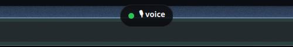

# hyprvoice

Audio-only notch for Hyprland on Arch Linux. An always-on-top pill at the
top-center of the screen — click it (or press `SUPER+R`) and dictate; the
transcript is typed into whatever text field was focused, in any app.
One Rust binary, Groq Whisper under the hood.



## How it works

```
click pill / SUPER+R → pw-record 16kHz mono → Groq whisper-large-v3-turbo
  → wl-copy + ydotool Ctrl+V into the focused app (focus never moves)
```

Click the pill to start recording (it turns red with a live timer), click
again to stop — transcription lands where you were typing ~1–3s later.
No window ever steals focus: the bind runs at the compositor level and
injection happens through `/dev/uinput`, so the target field stays active.

## Install

```sh
git clone https://github.com/Deji-Techh/hyprvoice.git && cd hyprvoice
cargo build --release
cp target/release/hyprvoice ~/.local/bin/hyprvoice
cp pill/shell.qml ~/.config/quickshell/hyprvoice-pill/shell.qml
cp hypr/hyprvoice.conf ~/.config/hypr/hyprvoice.conf
# in hyprland.conf:
#   source = ~/.config/hypr/hyprvoice.conf
systemctl --user enable --now ydotool.service
hyprctl reload
```

Needs: `pw-record` (PipeWire), `wl-clipboard`, `ydotool`, a Groq API key,
Quickshell (for the pill). The key resolves as `GROQ_API_KEY` env first,
then from Caide's `~/.caide/dyad-providers.json` (decrypted locally, same
cascade Caide uses) — `hyprvoice check-key` confirms without ever printing it.

### Verify

```sh
hyprvoice status       # idle | recording | transcribing
hyprvoice check-key    # groq key: present
hyprctl layers | grep hyprvoice   # Overlay layer, top-center
```

## Use

```sh
hyprvoice toggle                 # start if idle, else stop → transcribe → paste
hyprvoice start / hyprvoice stop  # explicit halves
hyprvoice transcribe file.wav    # transcribe + paste an existing file
```

Recordings shorter than 0.4s, under 8KB, or RMS-silence are discarded
locally — Whisper hallucinates ("Thank you.") on near-silence, so those
never hit the API. The last transcript is always kept in
`~/.cache/hyprvoice-last.txt`. Terminals are auto-detected and get
`Ctrl+Shift+V`; everything else gets `Ctrl+V`, with `ydotool type` as
fallback. Previous clipboard contents are restored after pasting.

## Pill

`pill/shell.qml` is a standalone `qs -c hyprvoice-pill` config, deliberately
*not* a Caelestia fork (Caelestia's bar has a fixed entry set and its windows
sit at `Top`, hidden under fullscreen). Ours pins `WlrLayer.Overlay` with
`exclusionMode: Ignore` and `exclusiveZone: 0` — above everything, never
moves your windows, tight click box. States: `🎙 voice` idle (green),
`● REC timer` recording (pulsing red), `… transcribing` (amber).

## Layout

```
src/main.rs     toggle state machine, pw-record capture, Groq request, WAV gates
src/keys.rs     Groq key cascade (env → encrypted Caide store → legacy .bin)
src/paste.rs    wl-copy + ydotool injection, terminal detection, clipboard restore
src/state.rs    pill state file ($XDG_RUNTIME_DIR/hyprvoice-state.json)
pill/shell.qml  Overlay notch (Quickshell)
hypr/           Hyprland binds + exec-once snippet
```

## Privacy

- Audio is sent to Groq for transcription (that's the STT engine); nothing
  else leaves the machine. No telemetry, no accounts.
- Keys stay in env / your existing Caide store — never logged, never printed.
- Guard rails mean accidental sub-second taps cost zero API calls.

## License

MIT — see [LICENSE](LICENSE).
